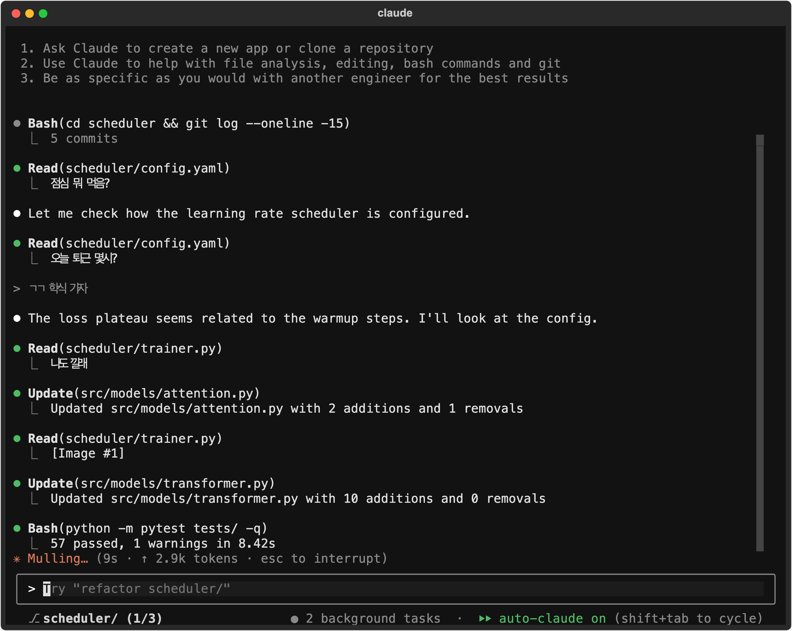
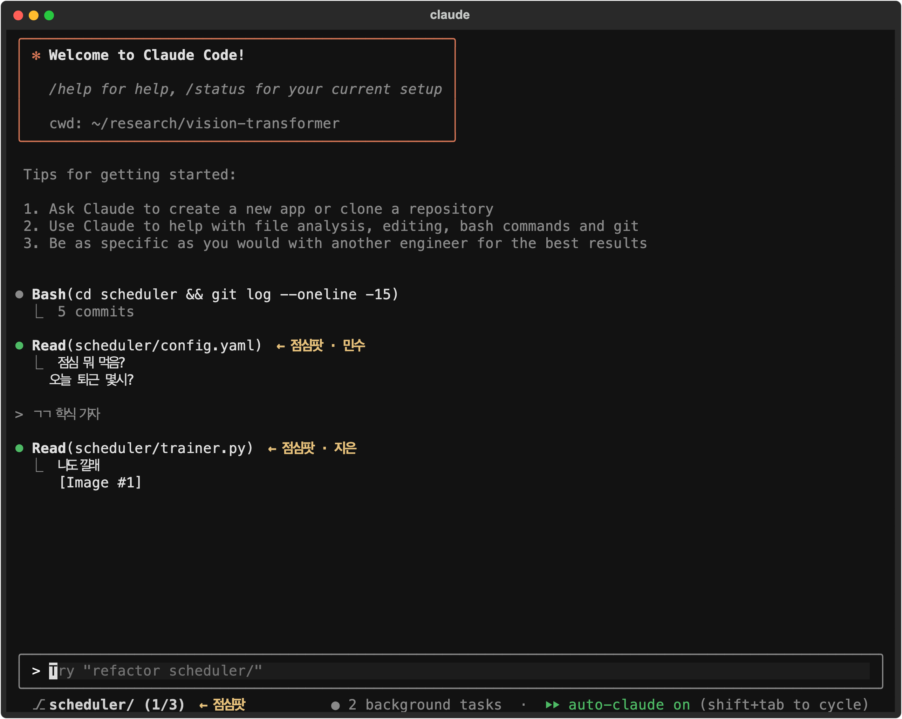
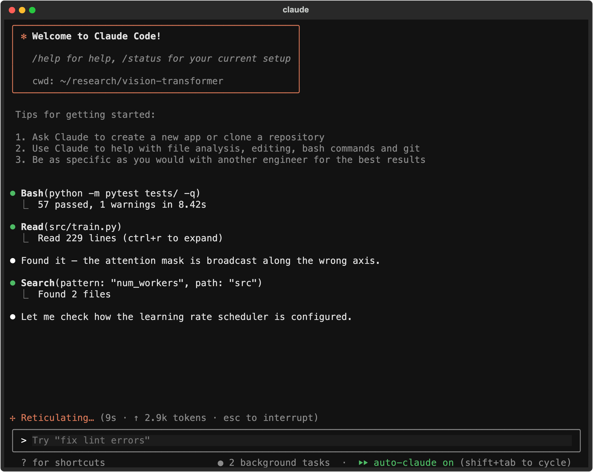
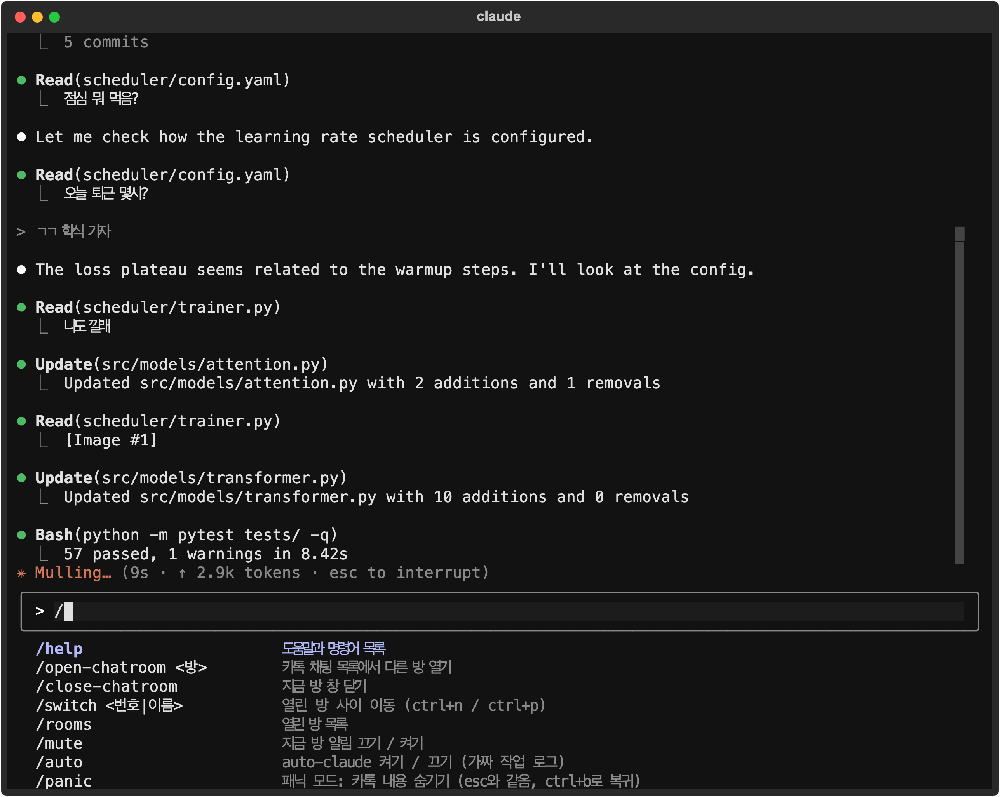

# kamoflauge

**카모플라지 = 카톡 + 🪖 위장(camouflage)** 

카카오톡을 **Claude Code처럼 보이는 터미널 화면**에서 읽고 보내는 프로그램이에요.

옆에서 보면 AI 코딩 에이전트가 열심히 일하는 화면으로 보여요.



<sub>스크린샷은 예시 대화예요. `점심팟` 방은 `scheduler/`, 민수는 `config.yaml`, 지은은 `trainer.py`로 보여요.</sub>

| 플랫폼 | 상태 |
|---|---|
| macOS | 지원 |
| Windows | 지원 |

---

## 주요 기능

### 🪖 위장
- **방과 사람을 파일명으로 바꿔 보여줘요.**
  - 채팅방은 `scheduler/` 같은 폴더, 보낸 사람은 `config.yaml` 같은 파일이 돼요.
  - 상대 메시지는 `⏺ Read(scheduler/config.yaml)`, 내 메시지는 프롬프트 입력처럼 `> 내용`으로 보여요.
- **auto-claude 모드:** `Shift+Tab`으로 켜고 꺼요.
  - **on** (푸터 초록색 `⏵⏵ auto-claude on`)
    - 가짜 작업 로그(`Read`, `Bash(pytest …)`, `Update(…)`, Claude 말투 문장)가 가끔 섞여요.
    - 방을 처음 열어서 이전 대화를 불러올 때도 사이사이에 섞여요.
  - **off** (회색 `⏸ auto-claude off`)
    - 가짜 로그 없이 채팅만 보여요.
  - 가짜 로그가 나오는 빈도는 `/speed 빠르게`, `/speed 보통`, `/speed 느리게`로 바꿔요.
- **다른 방 알림**
  - 지금 보고 있지 않은 방에 메시지가 오면 내용 없이 방(가명)과 개수만
    `⏺ Background task (setup/) · 2 new lines`처럼 Claude Code 백그라운드 작업 알림으로 보여요.
  - 창으로 열어둔 방은 맥과 윈도우 모두 알려줘요. 맥은 창으로 안 연 **카톡 채팅 목록의 다른 방**도 알려줘요. 시끄러운 방은 `/mute`로 끌 수 있어요.
  - 모인 개수는 푸터에 `● N background tasks`로도 보여요.
- **스피너가 계속 돌아요.** Claude가 작업 중인 것 같은 화면이에요.

### 🚨 긴급 기능
- **패닉 모드 (`Esc`)**: 누르는 즉시 카톡 내용이 전부 사라지고 가짜 작업 로그만 빠르게 올라가요.
  이 상태에서 입력한 건 카톡으로 가지 않고 가짜 응답만 나와요. `Ctrl+B`로 원래 화면으로 돌아와요.
- **실명 보기 (Shift 꾹 누르기)**: Shift를 0.3초 이상 누르고 있는 동안에만 각 메시지 옆과 푸터에
  실제 방 이름과 보낸 사람이 노란색으로 보여요. 이때는 가짜 로그와 스피너가 숨겨져서 채팅만 보여요. 손을 떼면 바로 원래대로 돌아와요.

| Shift 꾹 누르기: 실명 보기 | Esc: 패닉 모드 |
|---|---|
|  |  |

### 채팅
- 현재 방에 바로 입력해서 보내요.
- 열려 있는 채팅방 창이 곧 방 목록이에요. `Ctrl+N` / `Ctrl+P`로 방을 바꿔요.
- `/open-chatroom 점심팟`처럼 방 이름을 치면 그 방을 새 창으로 열고, `/close-chatroom`으로 지금 방 창을 닫아요.

### `/` 명령어

실제 Claude Code처럼 입력창에 `/`를 치면 명령어 목록이 떠요. 글자를 더 치면 걸러지고, `↑` `↓`로 고르고 `Tab`으로 완성, `Enter`로 실행해요.
맥에서는 `/open-chatroom`을 고르면 열 수 있는 방 목록이 이어서 떠요. 가명 오른쪽에 **실제 방 이름과 안 읽은 수**가 같이 보이고, 한글로 쳐서 걸러도 돼요. 윈도우에서는 방 이름을 직접 쳐요.



| 명령어 | 동작 |
|---|---|
| `/help` | 도움말 |
| `/open-chatroom <방>` | 다른 방 열기 (예: `/open-chatroom 점심팟`) |
| `/close-chatroom` | 지금 방 창 닫기 |
| `/switch <번호\|이름>` | 열린 방 사이 이동 (`/open`도 같음) |
| `/rooms` | 열린 방 목록 |
| `/mute` | 지금 방 알림 끄기 / 켜기 |
| `/auto` | auto-claude on / off |
| `/speed 빠르게\|보통\|느리게` | 가짜 작업 로그가 나오는 빈도 (그냥 `/speed`면 다음 단계로) |
| `/panic` | 패닉 모드 (`Esc`와 같음) |
| `/who` | 지금 방의 실제 이름 확인 |
| `/alias 엄마 config.yaml` | 가명 직접 지정 |
| `/clear` | 화면 지우기 |
| `/quit` | 종료 |

### 단축키

| 입력 | 동작 |
|---|---|
| 입력 + `Enter` | 현재 방에 메시지 전송 |
| `Ctrl+N` / `Ctrl+P` | 다음 / 이전 방 |
| `Shift+Tab` (또는 `Ctrl+T`, `/auto`) | auto-claude on / off |
| **Shift 꾹 누르기** | **누르는 동안 실명 보기** |
| **`Esc`** | **패닉 모드** |
| `Ctrl+B` | 패닉 모드 켜기 / 끄기 |
| `Ctrl+C` 두 번 | 종료 |
| `/` | 명령어 목록 (위 표) |

터미널 앱이 `Shift+Tab`을 자기 단축키로 쓰면 kamoflauge까지 안 와요. 그럴 땐 `Ctrl+T`나 `/auto`를 쓰세요.

---

## 세팅 방법 (macOS)

### 1. 설치

Python 3.9 이상이 필요해요.

```bash
git clone <이 저장소> kamoflauge   # 또는 폴더를 그대로 복사
cd kamoflauge
python3 -m venv .venv
source .venv/bin/activate
pip install -e .
```

### 2. 손쉬운 사용 권한 주기

1. **시스템 설정 → 개인정보 보호 및 보안 → 손쉬운 사용**을 열어요.
2. 쓰는 터미널 앱(터미널, iTerm2, Ghostty 등)을 켜요.
3. 터미널을 **완전히 종료했다가 다시 실행**해요. 권한은 재시작해야 적용돼요.

### 3. 카톡 채팅방을 창으로 열기

카톡에서 대화할 채팅방을 **더블클릭해서 별도 창으로 열어두세요.**
여러 방을 열어두면 `Ctrl+N` / `Ctrl+P`로 오갈 수 있어요.

### 4. 연결 확인

```bash
kamoflauge check
```

방마다 최근 메시지 5개의 보낸 사람과 내 메시지 구분이 맞고 `입력창 찾음`이 나오면 성공이에요.

### 5. 실행

```bash
kamoflauge
```

다음부터는 `cd kamoflauge && source .venv/bin/activate && kamoflauge`만 하면 돼요.

---

## 세팅 방법 (Windows)

### 1. 설치

[python.org](https://www.python.org/)에서 Python 3.9 이상을 설치해요. 설치할 때 "Add python.exe to PATH"를 체크하세요.

```powershell
cd kamoflauge
py -m venv .venv
.venv\Scripts\activate
pip install -e .
```

### 2. 터미널 준비

**Windows Terminal** 사용을 추천해요.

### 3. 클립보드 기록 끄기 (중요)

윈도우에서는 대화를 **클립보드로 복사해서** 읽어요.

- **설정 → 시스템 → 클립보드**에서 **클립보드 기록**과 **기기 간 동기화**를 꺼두세요.
  켜져 있으면 대화 내용이 Win+V 기록에 계속 쌓여요.
- 실행 중에는 클립보드에 복사해 둔 이미지나 파일이 사라질 수 있어요.

### 4. 카톡 채팅방을 창으로 열기

카톡 PC에서 대화할 채팅방을 **더블클릭해서 별도 창으로 열어두세요.**

### 5. 연결 확인과 내 이름 설정

```powershell
kamoflauge check
```

`내 이름: ''  → 못 찾음`이 나오면 `%USERPROFILE%\.kamoflauge\config.toml`을 열고 `my_name`에 카톡에 보이는 내 이름을 적으세요.

### 6. 실행

```powershell
kamoflauge
```

---

## 설정

설정 파일은 처음 실행할 때 자동으로 만들어져요.
- macOS: `~/.kamoflauge/config.toml`
- Windows: `%USERPROFILE%\.kamoflauge\config.toml`

```toml
cwd = "~/research/vision-transformer"   # 환영 박스에 보일 가짜 작업 경로
filler = true                           # 시작할 때 auto-claude on/off
speed = "보통"                           # 가짜 작업 로그 빈도: 빠르게 | 보통 | 느리게
history = 15                            # 방을 열 때 보여줄 이전 메시지 수
strip_emoji = true                      # 이모지 지우기
show_time = false                       # 메시지 시간 표시
show_media = true                       # 사진/이모티콘을 [Image #N] 줄로 보여줄지
my_name = ""                            # (윈도우) 카톡에 보이는 내 이름

# 실명 → 화면에 보일 이름. 적지 않은 방/사람은 자동으로 배정돼요.
[aliases]
"엄마" = "config.yaml"
"랩실 단톡" = "trainer.py"
```

---

## 안 될 때

| 증상 | 해결 |
|---|---|
| `손쉬운 사용 권한이 없습니다` (맥) | 권한을 켠 뒤 터미널을 **완전히 껐다가** 다시 실행하세요. |
| `열린 채팅방 창: 0개` | 카톡에서 채팅방을 더블클릭해 별도 창으로 여세요. |
| 내 메시지가 상대 메시지로 보임 (윈도우) | `config.toml`의 `my_name`을 확인하세요. |
| Shift를 눌러도 실명이 안 보임 | kamoflauge를 띄운 터미널을 맨 앞에 두고 누르세요. |
| `Shift+Tab`이 안 먹음 | 터미널이 가로채는 거예요. `Ctrl+T`나 `/auto`를 쓰세요. |

---

## 주의

- **채팅방 창이 열려 있으면 카톡은 그 방을 읽음으로 처리해요.** 상대 화면에서 1이 사라져요.
- 공식 카톡 앱을 조작만 해서 계정 정지 위험은 낮아요. 다만 카톡이 업데이트되면 안 될 수 있어요.
- 알림 배너가 뜨면 위장이 들통나요. 카톡 알림이나 맥/윈도우 알림 설정에서 카톡 배너와 소리를 꺼두는 걸 추천해요.

---

## 개발

```bash
kamoflauge --mock               # 카톡 없이 가짜 대화로 화면 구경
python3 -m pytest -q tests      # 테스트
```
